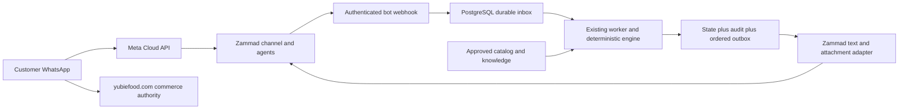

# Yubi V2 architecture

Yubi discovers products, explains approved facts, navigates the official website,
and requests human support. The website alone owns accounts, carts, addresses,
checkout, payments and orders. There is no WhatsApp commerce mutation action.
This user-approved scope supersedes the earlier WhatsApp-first commerce proposal.
Website launch profiles and financial release gates remain unchanged.

The existing modular monolith, PostgreSQL and pg-boss remain. Zammad is the sole
WhatsApp channel and agent UI; no direct Meta outbound client or competing bot.
Provider-neutral commands live in application; catalog truth in domain; policy in
assistant; Zammad and image decoding in integrations; SQL/transactions in persistence.
API/bot are transport adapters, and the worker runs durable effects.

Ingestion: authenticate and bound stream → durable inbox → acknowledge → queue
wakeup. Wakeup failure does not lose an acknowledged event; the ten-second sweep
repairs it. Zammad customer article identity is provider/ticket/article, independent
of payload encoding/delivery ID. Actual customer article is re-fetched; bot/agent
articles cannot create reply loops. Lifecycle triggers must omit article_id.

Turns hold a per-thread PostgreSQL advisory transaction lock. A savepoint rolls
back failed state, runs, audit and outbox together; failure counting commits under
the same lock. Durable pending inputs are ordered; lifecycle events latch closure
first. Five failures produce one recovery handoff and a retained failed inbox row.
Late navigation resets safely; explicit human/health/safety escalation retains
priority. Ownership and navigation use separate tables.

The outbox claims at dispatch, uses bounded retries and ordered dependencies, and
distinguishes REST accepted, sent, delivered, ambiguous, failed and cancelled.
Unknown writes are reconciled by the article delivery marker, never blindly
reposted. Only internal safety routing uses convergent group/priority/tag retries.
The channel and customer receipt must confirm real WhatsApp delivery in R3/R5.

Before each public POST, the adapter and worker recheck ownership, mode,
capabilities and the customer-service window. Routine handoff mutations carry a
fresh authorization callback before each write. OFF/takeover stops remaining
effects; an already dispatched request can complete and must be reconciled.
Safety routing remains internal under OFF/human ownership.

Capabilities are a projection of the existing launch profile and protected
website_release evidence, not five new environment flags. All catalog routes,
artifact digest, clean source and approval must be present. Public catalog has
no account/checkout/order capability. Accepted sandbox capabilities can be used
only in development/test/staging; production checkout remains disabled. Support
acceptance is tied to the exact bot RELEASE_SHA. No source page's existence grants
operational availability.

V2 selection is an audited operator operation. It downgrades existing AUTO to
shadow, preserves OFF, and requires separate activation. Production V2 AUTO is
blocked without four approved final photos, approved catalog artifact and exact
support/operations acceptance. Defaults remain V1/shadow. Rollback uses this
compatible artifact's V1 selector after OFF; additive migrations are retained.
